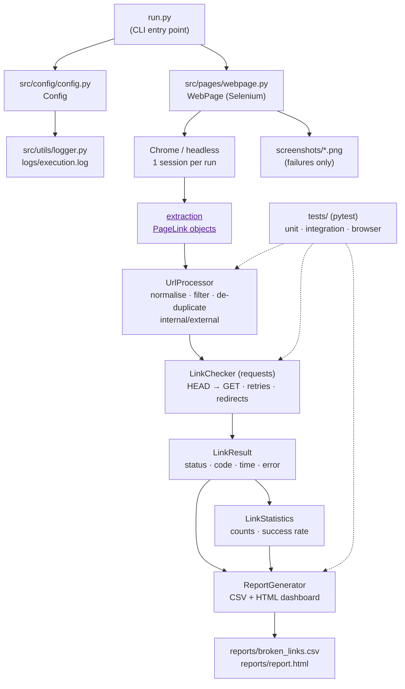

# Automated Web Broken Link Detection and Reporting System

> A Selenium + Requests based **automation testing framework** that crawls a web page,
> validates every hyperlink, classifies the results and generates a QA dashboard with
> CSV evidence, screenshots and logs.


> **This project is a test automation framework, not a website.** It contains no
> frontend application, no backend service and no database. It is a *test tool*:
> it drives a browser, validates links and produces test artefacts.

---

## 1. Project Overview

Broken links silently damage the user experience and SEO ranking of a website.
Checking them manually does not scale: a single page can contain hundreds of
links scattered across internal pages, external partners, mail and phone links.

**Automated Web Broken Link Detection and Reporting System** automates that
check completely:

1. Selenium opens the configured website in Chrome (headless by default) and
   extracts every `<a href>` element.
2. The URLs are normalised, filtered, classified as internal/external and
   de-duplicated.
3. `requests` validates every unique URL with HEAD/GET requests, following
   redirects, retrying transient failures and capturing status codes,
   response times and errors.
4. Each link becomes a structured `LinkResult` with a clear status
   (WORKING, REDIRECT, CLIENT_ERROR, TIMEOUT, ...).
5. A CSV export, a JavaScript-enhanced HTML dashboard, screenshots and a log
   file are produced as test evidence.
6. `pytest` verifies the framework itself (94 tests across three categories).

## 2. Problem Statement

| Manual checking | Automated framework |
| --- | --- |
| A human clicks every link | Selenium + requests do it in seconds |
| Easy to miss hidden/duplicate links | Every anchor is extracted, duplicates counted |
| No evidence for a bug report | CSV + HTML dashboard + screenshots + logs |
| Not repeatable | One command, deterministic output, CI ready |
| No statistics | Success rate, redirects, internal/external, timings |

Manual verification of links is slow, unrepeatable and impossible to run on
every commit. This framework turns the same activity into an automated,
regression-safe test that can run locally or in GitHub Actions.

## 3. Objectives

1. Extract **all** hyperlinks of a page reliably using a real browser
   (JavaScript-rendered links included).
2. Normalise and validate URLs correctly (relative → absolute, no fragments,
   no `mailto:`/`tel:`/`javascript:` noise, duplicates removed).
3. Classify and validate each unique link over HTTP with retries, timeouts and
   graceful error handling.
4. Produce professional, human readable reports plus machine readable data.
5. Keep the framework modular, testable and CI/CD ready, with zero external
   frontend dependencies.
6. Never harm the target website: only normal GET/HEAD requests are sent, with
   conservative concurrency and a configurable link limit.

## 4. Features

- **Selenium page extraction** - one browser session per run, explicit waits
  (`document.readyState` + `<body>`), no arbitrary `sleep`.
- **Robust URL processing** - absolute/relative resolution, query strings
  preserved, duplicate separators collapsed, fragments and non-web protocols
  filtered.
- **Duplicate handling** - a URL is requested once, the number of occurrences is
  reported (`occurrences` column).
- **Internal vs external classification** - with an option to skip external
  domains (`--no-external`).
- **HTTP validation with retries** - HEAD first, GET fallback, redirect
  following, retry/backoff for 408/425/429/5xx, connection and timeout errors.
- **Clear status model** - WORKING, REDIRECT, CLIENT_ERROR, SERVER_ERROR,
  BLOCKED, TIMEOUT, CONNECTION_ERROR, SSL_ERROR, INVALID, SKIPPED.
- **CSV + HTML dashboard reporting** - KPI cards, success rate, status filters,
  live search and sortable columns (plain JavaScript, no framework).
- **Logging to `logs/execution.log`** with rotation and 4 log levels.
- **Screenshot evidence** on page-level failures and when broken links are found.
- **Pytest suite** (unit / integration / browser) and **GitHub Actions CI**.
## 5. Technology Stack

| Layer | Technology | Why |
| --- | --- | --- |
| Language | Python 3.13 | type hints, `StrEnum`, dataclasses |
| Browser automation | Selenium 4 (Chrome, headless) | renders JavaScript, extracts the DOM anchors |
| HTTP validation | Requests (+ urllib3 connection pooling) | status codes, redirects, timeouts, retries |
| Test framework | Pytest | fixtures, markers, parametrisation |
| Reporting | CSV + HTML/CSS/JavaScript | machine readable data + QA dashboard |
| Logging | `logging` + `RotatingFileHandler` | `logs/execution.log` evidence |
| CI/CD | GitHub Actions | runs the suite on every push/PR |

No Flask, no Django, no React, no pandas and no other unnecessary dependency.

## 6. Architecture



Design rules that keep the project maintainable:

* **Single source of truth** - every setting lives in `Config` (`src/config/config.py`).
* **Single Selenium owner** - only `WebPage` touches the browser; one browser
  session per run (never one per link).
* **Pure logic is separated from I/O** - `UrlProcessor`, status classification
  and statistics can be tested without network or browser.
* **No silent failures** - every failure becomes a `LinkResult` with a status
  and an error message; the run always produces reports.

## 7. Project Structure

```text
BrokenLinkAutomation/
|
├── src/
│   ├── pages/
│   │   ├── __init__.py
│   │   └── webpage.py            # WebPage: Selenium extraction + screenshots
│   ├── utils/
│   │   ├── __init__.py
│   │   ├── link_checker.py       # LinkStatus, LinkResult, UrlProcessor,
│   │   │                         # LinkChecker, LinkStatistics
│   │   ├── report_generator.py   # CSV + HTML dashboard + console summary
│   │   └── logger.py             # logging to logs/execution.log
│   └── config/
│       ├── __init__.py
│       └── config.py             # Config dataclass + defaults + paths
│
├── tests/
│   ├── __init__.py
│   ├── conftest.py               # fixtures: inline test site, configs, browser
│   ├── test_broken_links.py      # unit / integration / browser tests
│   └── test_test_site.py         # tests for the local demo website
│
├── test_site/                    # local demo website (standard library only)
│   ├── index.html                # working / broken / redirect / duplicate links
│   ├── about.html                # 200 OK target and redirect destination
│   └── server.py                 # python test_site/server.py  ->  :8000
│
├── reports/                      # broken_links.csv, report.html (generated)
├── screenshots/                  # PNG evidence of failures (generated)
├── logs/                         # execution.log (generated)
│
├── .github/workflows/tests.yml   # CI: pytest on push / pull request
├── requirements.txt
├── pytest.ini
├── run.py                        # main entry point
├── broken_link_checker.py        # legacy entry point (thin shim -> run.py)
└── README.md
```

## 8. How It Works

| Step | What happens | Code |
| --- | --- | --- |
| 1 | Load configuration (defaults → env → CLI) | `Config.from_env()`, `config_from_args()` |
| 2 | Configure logging (console + `logs/execution.log`) | `get_logger()` |
| 3 | Start Chrome once, headless by default | `WebPage.start_browser()` |
| 4 | Open the target URL, wait for `document.readyState` + `<body>` | `WebPage.open_page()` |
| 5 | Extract every `<a>` element (href + text) | `WebPage.get_links()` |
| 6 | Normalise, filter, classify, de-duplicate, count occurrences | `UrlProcessor.build_inventory()` |
| 7 | Validate each unique URL (HEAD → GET, redirects, retries) | `LinkChecker.check_links()` |
| 8 | Classify every result and compute statistics | `classify_status_code()`, `LinkStatistics` |
| 9 | Write CSV + HTML dashboard, capture failure screenshot | `ReportGenerator.generate()` |
| 10 | Print the summary and release the browser | `print_console_summary()`, `WebPage.close()` |

## 9. Installation

```bash
# 1. clone the repository
git clone https://github.com/<your-username>/BrokenLinkAutomation.git
cd BrokenLinkAutomation

# 2. create and activate a virtual environment
python -m venv .venv
# Windows (PowerShell)
.venv\Scripts\Activate.ps1
# macOS / Linux
source .venv/bin/activate

# 3. install the dependencies
python -m pip install --upgrade pip
python -m pip install -r requirements.txt
```

Requirements: Python 3.13+, Google Chrome (or Firefox/Edge) and internet access
for the website you want to check.

## 10. Configuration

All settings live in **`src/config/config.py`** (`Config`). Priority:
**CLI flag > `BLA_*` environment variable > default**.

```python
target_url          = "https://example.com"  # website to test
check_external_links= True                   # also check other domains
max_links           = 500                    # safety limit (0 = unlimited)
browser             = "chrome"               # chrome | firefox | edge
headless            = True                   # no visible browser window
window_size         = "1920,1080"
page_load_timeout   = 30                     # seconds
element_timeout     = 15                     # explicit wait timeout
request_timeout     = 15.0                   # HTTP read timeout
connect_timeout     = 7.5                    # HTTP connect timeout
max_retries         = 2                      # retries for transient failures
retry_backoff       = 0.5                    # seconds, multiplied per attempt
max_workers         = 8                      # parallel HTTP workers
verify_ssl          = True
user_agent          = "Mozilla/5.0 ... BrokenLinkAutomation/1.0"
screenshot_on_failure = True
ignore_patterns     = ("^#", "/cdn-cgi/", r"[?&](logout|signout|delete|cancel)=")
reports_dir / screenshots_dir / logs_dir     # output folders (pathlib.Paths)
log_level           = "INFO"
```

Environment variables (useful in CI): `BLA_TARGET_URL`, `BLA_MAX_RETRIES`,
`BLA_HEADLESS`, `BLA_MAX_LINKS`, `BLA_CHECK_EXTERNAL_LINKS`, `BLA_REQUEST_TIMEOUT`,
`BLA_MAX_WORKERS`, `BLA_LOG_LEVEL`, `BLA_USER_AGENT`, `BLA_IGNORE_PATTERNS`, ...

```powershell
# Windows PowerShell
$env:BLA_TARGET_URL="https://your-site.com"; python run.py
$env:BLA_LOG_LEVEL="DEBUG"; python run.py --max-links 25
```

```bash
# macOS / Linux
BLA_TARGET_URL="https://your-site.com" python run.py
```

## 11. Running the Project

```bash
# default target from the configuration
python run.py

# explicit website
python run.py --url https://example.com

# visible browser, only the first 50 links, skip external domains
python run.py --url https://example.com --no-headless --max-links 50 --no-external

# more patient checking on a slow network
python run.py --url https://example.com --timeout 30 --retries 4

# legacy entry point (identical behaviour)
python broken_link_checker.py --url https://example.com
```

| Flag | Meaning |
| --- | --- |
| `--url` | target website |
| `--browser` | `chrome`, `firefox` or `edge` |
| `--headless` / `--no-headless` | show or hide the browser window |
| `--max-links` | maximum number of unique links to check |
| `--external` / `--no-external` | check or skip external domains |
| `--timeout`, `--retries`, `--max-workers` | HTTP behaviour |
| `--screenshot` / `--no-screenshot` | save failure screenshots |
| `--reports-dir`, `--log-level` | output folder and verbosity |

**Exit codes:** `0` = no broken links, `1` = broken links found (a failing test),
`2` = runtime error (page could not be opened). CI can therefore treat the run
as a quality gate.

## Local Demo Website

A tiny, deliberately imperfect website lives in `test_site/` so the detector can
be demonstrated and validated without touching the internet or anyone else's
server. It uses the Python standard library only - **no extra dependency** - and
it is *not* wired into the configuration: you point the framework at it with the
normal `--url` flag, so nothing about your real targets changes.

### 1. Open a terminal and start the local server

```bash
python test_site/server.py                # http://localhost:8000
python test_site/server.py --port 9000    # if port 8000 is busy
python test_site/server.py --port 0       # pick any free port
```

The banner tells you exactly what is being served:

```text
================================================================
Broken Link Automation - local demo website
================================================================
Serving files from : ...\test_site
Open in Chrome     : http://localhost:8000
                     http://127.0.0.1:8000
Routes             : /               -> index.html   (200 OK)
                     /about.html     -> about.html   (200 OK)
                     /redirect       -> 302 -> /about.html
                     /does-not-exist -> 404 Not Found (on purpose)

Scan it with       : python run.py --url http://localhost:8000
Stop the server    : Ctrl+C
================================================================
```

Open `http://localhost:8000` in Chrome to see the test page.

### 2. In a second terminal, activate the virtual environment

```powershell
.venv\Scripts\Activate.ps1      # Windows PowerShell
```

```bash
source .venv/bin/activate       # macOS / Linux
```

### 3. Run the automation against http://localhost:8000

```bash
python run.py --url http://localhost:8000
```

No configuration file has to be edited: `--url` overrides the target for that one
run (`python run.py --help` lists every flag). Useful variants:

```bash
python run.py --url http://localhost:8000 --no-headless      # watch the browser work
python run.py --url http://localhost:8000 --reports-dir reports/demo
python run.py --url http://localhost:8000 --no-external      # offline: skip example.com
python broken_link_checker.py --url http://localhost:8000    # legacy entry point
```

### 4. Open the generated report

```text
reports/broken_links.csv     machine readable result of every link
reports/report.html          QA dashboard (open in Chrome)
logs/execution.log           full run log
screenshots/*.png            evidence - saved because broken links were found
```

### What you should expect

| # | Link on the demo page | Reported status | Reason |
| --- | --- | --- | --- |
| 1 | `http://localhost:8000/about.html` | `WORKING` / **200** | the file exists |
| 2 | `http://localhost:8000/does-not-exist` | `CLIENT_ERROR` / **404** | missing file → **broken** |
| 3 | `http://localhost:8000/redirect` | `REDIRECT` / **302** → `/about.html` | server answers 302 |
| 4 | `about.html` (relative link) | `WORKING` / **200** | resolved to the absolute URL |
| 5 | `https://example.com` | `WORKING` / **200**, type `external` | needs internet; `--no-external` → `SKIPPED` |
| 6 | `about.html` twice more | checked **once**, `Occurrences = 4` | duplicate detection |
| 7 | `mailto:test@example.com` | `SKIPPED` | a mail link is never requested |
| 8 | `javascript:void(0)` | `SKIPPED` | a JavaScript link is never requested |

Rule of thumb for the demo: **200 → working**, **3xx → redirect** (not broken),
**404/5xx → broken**, **mailto/javascript/# → skipped**.

Because the demo page contains one broken link, `run.py` finishes with exit code
`1` and the dashboard shows a `FAIL` verdict - while the redirect, the duplicate
and the skipped links are listed with their own status, which is exactly what
makes the demo convincing.

The demo server itself is covered by `tests/test_test_site.py`: those tests start
the server **in-process on a random port**, so the test suite never depends on a
permanently running server and never clashes with a demo you started yourself.

## 12. Running Tests

```bash
# everything (browser tests are skipped automatically when no browser exists)
pytest

# verbose, with the slowest tests listed
pytest -v

# only the fast unit tests
pytest -m unit

# only the HTTP integration tests (local test server, no internet)
pytest -m integration

# only the Selenium browser tests
pytest -m browser

# HTML report of the pytest run itself
pytest --html=reports/pytest_report.html --self-contained-html

# single class / single test
pytest tests/test_broken_links.py -k TestUrlNormalisation
```

### Test categories

| Category | Marker | Count | What it proves |
| --- | --- | --- | --- |
| Unit | `@pytest.mark.unit` | 68 | URL normalisation, filtering, duplicate counting, status classification, statistics, report rendering, browser options, CLI parsing |
| Integration | `@pytest.mark.integration` | 17 | Real HTTP requests against a **local test server**: 200/404/403/500, redirects, HEAD→GET fallback, timeouts, unreachable hosts, retries, full pipeline |
| Browser / UI | `@pytest.mark.browser` | 9 | Selenium loads the page, extracts the anchors, captures a screenshot on failure, and the whole `run.py` flow works end to end |

Unit and integration tests never touch the internet: `tests/conftest.py` starts a
small deliberately broken website on `127.0.0.1` with `/missing.html` (404),
`/forbidden` (403), `/server-error` (500), `/redirect`, `/head-not-allowed`,
`/slow` and `/flaky` (fails twice with 503, then recovers). That keeps the suite
fast, deterministic and offline-friendly, while still exercising real sockets.

## 13. Reports

Both reports are always written, even when everything passes.

### `reports/broken_links.csv`

| Column | Example | Meaning |
| --- | --- | --- |
| `source_page` | `https://example.com/` | page the link was found on |
| `url` | `https://example.com/about` | normalised, de-duplicated URL |
| `link_type` | `internal` / `external` / `non-web` | classification |
| `status` | `WORKING` | status category |
| `status_code` | `200` | HTTP code (empty when there was no response) |
| `response_time` | `0.184` | seconds |
| `occurrences` | `3` | how often the link appeared on the page |
| `final_url` | `https://example.com/about/` | URL after redirects |
| `error` | `Not Found` | reason phrase or exception message |
| `checked_at` | `2026-09-29T11:20:31` | timestamp of the check |

### `reports/report.html` - QA dashboard

* verdict badge (`PASS` / `FAIL`) next to the target website
* execution date/time, total execution time, success rate and *reachable*
  rate (working + redirects - a redirect is not a broken link)
* 12 KPI cards: total links found, unique discovered, unique checked, working,
  broken, redirects, blocked, skipped, timeout errors, connection errors,
  internal links, external links
* detailed table: URL · Type · Status · HTTP Code · Final URL · Response Time ·
  Error · Occurrences
* **live search** (JavaScript), **status filters** (working/broken/redirect/…)
  and **sortable columns** - plain JavaScript, no CDN and no framework
* colour coding: green working, red broken, amber redirect, grey skipped

### Other artefacts

| Path | Content |
| --- | --- |
| `logs/execution.log` | full run log (rotated at ~1 MB, 5 backups kept) |
| `screenshots/<timestamp>_*.png` | evidence of page failures / broken links |
| `reports/pytest_report.html` | optional pytest HTML report (`--html=...`) |

## 14. Error Handling

| Situation | Behaviour |
| --- | --- |
| Browser cannot start | `PageLoadError`, exit code 2, error logged |
| Page does not load / times out | `PageLoadError`, screenshot saved, exit code 2 |
| A single link fails | recorded as a `LinkResult` - the run continues |
| `HEAD` not allowed (405/403/501/400) | automatically retried with `GET` |
| Redirect chain | followed; reported as `REDIRECT` with the final URL |
| 401/403/429 | `BLOCKED` (exists but refuses automation) - not counted broken |
| 5xx, 408, 425, 429 | retried with backoff up to `max_retries` |
| Timeout / DNS / refused connection | `TIMEOUT` / `CONNECTION_ERROR`, retried |
| Invalid or untrusted TLS certificate | `SSL_ERROR` (set `verify_ssl=False` knowingly) |
| `mailto:`, `tel:`, `javascript:`, `#` | `SKIPPED`, still listed in the report |
| More unique links than `max_links` | the overflow is reported as `SKIPPED` |
| Any unexpected exception | logged with traceback, screenshot, exit code 2 |

Nothing is swallowed silently: every failure has a status, an error message and
a line in `logs/execution.log`.

## 15. CI/CD

`.github/workflows/tests.yml` runs on every push, pull request and manual
dispatch: checkout → Python 3.13 → `pip install -r requirements.txt` →
`pytest -v -m "unit or integration"` (browser tests are deselected because the
runner has no browser installed) → `reports/` and `logs/` are uploaded as build
artefacts.

```bash
# reproduce the CI run locally
pytest -v -m "unit or integration" --junitxml=reports/junit.xml
```

## 16. Future Enhancements

* Crawl several pages of the same domain (BFS with a depth/page limit).
* Store results in SQLite and diff two runs to detect **newly broken links**.
* Support `sitemap.xml` as an alternative starting point.
* Parallel page extraction and per-domain politeness/rate limiting.
* Slack / Teams / e-mail notification when the quality gate fails.
* Visual regression check of the extracted page (screenshot diffing).
* Trend dashboard: success rate per run, per release, per branch.

## 17. Example Output

```text
========================================
BROKEN LINK AUTOMATION TEST
========================================

Target:  https://example.com
Started: 2026-09-29 14:15:11
Mode:    Selenium extraction + requests validation

Total Links Found:    25
Unique Links Checked: 20
Working:              17
Broken:               2
Redirects:            1
Skipped:              5

Success Rate: 85%   (reachable incl. redirects: 90%)
Execution Time: 6.42s

Broken links:
  - [404] https://example.com/products/old-page (Not Found)
  - [500] https://example.com/api/status (Internal Server Error)

Reports:
  reports/broken_links.csv
  reports/report.html
========================================
```

Verbatim output of a real run of this repository (`python run.py --url https://example.com`):

```text
Target:  https://example.com/
Started: 2026-09-29 14:15:11
Mode:    Selenium extraction + requests validation

Total Links Found:    1
Unique Links Checked: 1
Working:              0
Broken:               0
Redirects:            1
Skipped:              0

Success Rate: 0.0%   (reachable incl. redirects: 100.0%)
Execution Time: 7.35s

Broken links:
  - none, every link responded correctly

Reports:
  ...\reports\broken_links.csv
  ...\reports\report.html
```

And the test suite:

```text
$ pytest -q
94 passed in 54.20s
```

The generated dashboard (`reports/report.html`) looks like this: a header with the
`PASS`/`FAIL` badge, four meta cards (target, date/time, duration, success +
reachable rate), twelve KPI cards, then the filter/search toolbar and the link
table with colour coded status chips.

## 18. Viva Explanation

**What exactly is this project?**
An *automation testing framework* for websites. There is no website, no UI for
end users and no database: the deliverables are the test run, the reports
(CSV + HTML dashboard), the screenshots and the log file.

**Why Selenium *and* Requests? Why not only one of them?**
`requests` can download HTML, but it cannot see links that JavaScript adds after
the page loads, and it cannot prove that a real browser renders the page.
Selenium drives Chrome, waits until the page is genuinely ready
(`document.readyState == 'complete'`), then reads the DOM - exactly what a QA
engineer does manually. Validating the links is then far cheaper with `requests`:
opening a browser for every link would be unusable (seconds per link, heavy,
flaky). So: **one browser session for extraction, HTTP with connection pooling
for validation** - the same split commercial link checkers use.

**How are duplicates and repeated work avoided?**
`UrlProcessor` normalises every URL (relative → absolute, fragment removed, host
lower-cased, duplicate slashes collapsed) and records how often each link
appeared on the page. Every unique URL is requested **once**, while the report
still shows `Occurrences = 4`, so no information is lost.

**What is the difference between WORKING, REDIRECT, BLOCKED and BROKEN?**
* `WORKING` - 2xx, the link resolves.
* `REDIRECT` - 3xx: followed to the end, reported with the final URL (not broken,
  but worth knowing).
* `BLOCKED` - 401/403/429: the resource exists but refuses automated traffic, so
  it is reported separately instead of being called "broken".
* `BROKEN` - a hard failure: 4xx/5xx, timeout, connection error, SSL error or an
  invalid URL. `LinkStatistics.broken` counts exactly these.

**How does the framework stay reliable and fast?**
Deterministic status classification, explicit retries with backoff for transient
failures (5xx, 408/425/429, timeouts, refused connections), no arbitrary `sleep`
(explicit waits only), graceful handling of every exception, exit codes CI can
interpret, and 93 automated tests - including integration tests against a
*local*, deliberately broken website, so the suite is fast, offline and
repeatable.

**How would this be used in a real company?**
Add it to CI as a quality gate: `pytest` for the framework, `python run.py
--url https://staging.example.com` for the nightly smoke test. Exit code `1`
(= broken links found) fails the pipeline, and the HTML dashboard + CSV are
attached as evidence for the bug ticket.

**Which software engineering concepts does it demonstrate?**
Layered/Page-Object architecture, separation of pure logic from I/O, dataclasses
and `StrEnum` for a typed domain model, dependency-injected configuration,
`pathlib` for cross-platform paths, rotating logs, HTML/CSS/JS reporting without
any frontend framework, pytest fixtures/markers/parametrisation, and CI/CD with
GitHub Actions.

## 19. Author & License

Built as a portfolio project for a B.Tech CSE student applying for software
testing / automation internships. Free to use, study and modify - add your own
`LICENSE` file (MIT recommended) before publishing the repository.


